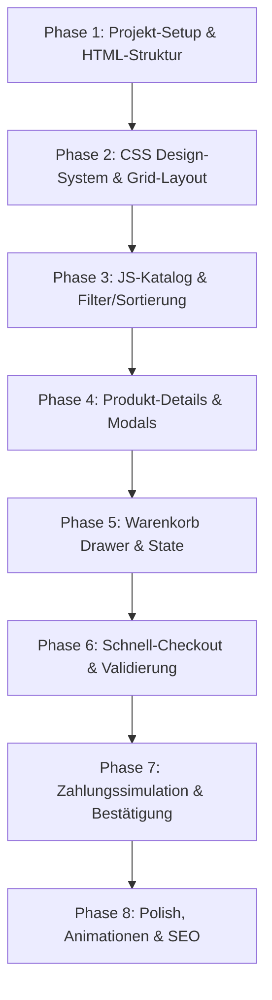

# Entwicklungsplan (Developer Plan) – Roast - Café

Dieser Plan führt Claude Code Schritt für Schritt durch die technische Umsetzung der Website. Er ist so konzipiert, dass jede Phase separat implementiert, getestet und verifiziert werden kann.

---

## Übersicht der Entwicklungsphasen

---

## Phase 1: Projekt-Setup & HTML-Struktur
**Ziel:** Erstellung der Verzeichnisstruktur und des semantischen HTML5-Skeletts.

1.  **Dateien erstellen:**
    *   `index.html` (Hauptseite)
    *   `styles.css` (Stylesheets)
    *   `app.js` (JavaScript-Logik)
2.  **HTML-Struktur aufbauen:**
    *   `<header>` mit Logo, Navigation und Warenkorb-Button.
    *   `<main>` mit drei Hauptsektionen:
        *   `<section id="hero">`: Hero-Bereich mit Call-to-Action.
        *   `<section id="kollektion">`: Filter-Leiste und Produkt-Grid Container.
        *   `<section id="story">`: Textbasierter Über-uns-Bereich.
    *   `<footer>` mit Newsletter-Formular und rechtlichen Links.
    *   **Overlays & Modals (versteckt):**
        *   Warenkorb-Drawer (`#cart-drawer`).
        *   Produkt-Detail-Modal (`#product-modal`).
        *   Checkout-Modal (`#checkout-modal`).

---

## Phase 2: CSS Design-System & Grid-Layout
**Ziel:** Aufbau der visuellen Ästhetik (Modern Dark, Grid, Glassmorphismus).

1.  **Google Fonts einbinden:**
    *   `Space Grotesk` (für Titel und Überschriften)
    *   `Inter` (für Lesetext)
    *   `Space Mono` (für Preise und Metadaten)
2.  **CSS-Variablen definieren:**
    *   Farbpalette, Schriftarten, Blur-Effekte und Übergangs-Dauer (aus `requirements.md` entnehmen).
3.  **Raster-Hintergrund (Grid Background) implementieren:**
    *   Ein dezenter, feiner Gittereffekt auf dem `<body>` mit CSS-Hintergrundlinien (z.B. mittels `linear-gradient` in zwei Richtungen) erzeugen.
4.  **Basis-Styling & Layout-Raster:**
    *   Zentriertes Layout für alle Sektionen mit maximaler Breite (z. B. `max-width: 1200px`).
    *   Styling von Header (sticky, mit Backdrop-Filter-Verschwommenheit beim Scrollen) und Footer.

---

## Phase 3: JS-Katalog & Filter/Sortierung
**Ziel:** Dynamisches Laden der Kaffeeprodukte und clientseitige Filterung.

1.  **Produktdaten-Array in `app.js` anlegen:**
    *   Eintragen der 4 Produkte aus `copy_assets.md` (inkl. Name, Preis, Herkunft, Röstgrad, Geschmacksprofil, Bildpfad).
2.  **Render-Funktion schreiben:**
    *   Funktion `renderProducts(products)`, die HTML-Produktkarten generiert und in das Grid einfügt.
3.  **Filter-Logik implementieren:**
    *   Event-Listener für die Filter-Tabs (Alle, Espresso, Filterkaffee, Decaf).
    *   Filtern des Arrays nach Kategorie bei Klick.
4.  **Sortier-Logik implementieren:**
    *   Sortieren des Arrays nach Preis aufsteigend/absteigend oder Beliebtheit.

---

## Phase 4: Produkt-Details & Modals
**Ziel:** Detailansicht für Produkte mit Konfigurationsoptionen.

1.  **Modal-Steuerung:**
    *   Öffnen- und Schließen-Funktionen für `#product-modal`.
    *   Schließen bei Klick auf das "X", außerhalb des Modals (Overlay-Klick) oder Drücken der `Escape`-Taste.
2.  **Detaillierte Produkt-Rendierung:**
    *   Bei Klick auf eine Produktkarte das Modal mit den passenden Produktdaten befüllen (Beschreibung, Herkunft, Aufbereitung).
3.  **Optionen-Auswahl:**
    *   Packungsgröße (250g, 500g, 1000g) mit Preisanpassungs-Logik verknüpfen.
    *   Mahlgrad-Auswahl über Buttons oder Dropdown.
4.  **Mengenregler:**
    *   Plus- und Minus-Buttons, die den Mengenwert (Standard: 1) manipulieren (Mindestmenge: 1).

---

## Phase 5: Warenkorb Drawer & State
**Ziel:** Verwaltung des Einkaufswagens (Hinzufügen, Entfernen, Berechnen).

1.  **Warenkorb-State (`cart` Array):**
    *   Jeder Eintrag enthält: `productId`, `name`, `price`, `grind`, `size`, `quantity`, `image`.
2.  **Hinzufügen-Logik ("Add to Cart"):**
    *   Aus dem Detail-Modal Daten sammeln und im State-Array speichern. Falls gleiches Produkt mit gleicher Option existiert, Menge addieren.
    *   Warenkorb-Counter im Header aktualisieren.
3.  **Warenkorb rendern:**
    *   Warenkorb-Drawer befüllen: Produktbilder, Name, gewählte Optionen, Einzelpreise, Mengensteuerung und Entfernen-Button.
4.  **Summen & Versandgrenzen berechnen:**
    *   Berechnung der Zwischensumme, der Versandkosten (gratis ab 45 €) und des Gesamtbetrags.
5.  **LocalStorage-Synchronisierung:**
    *   Speichern des Arrays nach jeder Änderung, Laden des Warenkorbs beim Seitenstart.

---

## Phase 6: Schnell-Checkout & Validierung
**Ziel:** Ablenkungsfreies Ausfüllen der Bestelldaten mit Fehlerüberprüfung.

1.  **Checkout-Modal aufrufen:**
    *   Klick auf "Zur Kasse" schließt den Warenkorb-Drawer und öffnet das Checkout-Modal.
2.  **Layout & Formulargestaltung:**
    *   Zweispaltiges Layout auf Desktop (Links Eingaben, rechts Zusammenfassung).
    *   Zahlungsmethoden-Auswahl (bei "Kreditkarte" erscheinen die Felder für Kartennummer, Datum und CVC).
3.  **Validierungs-Funktionen:**
    *   Validierung aller Pflichtfelder beim Absenden.
    *   Echtzeit-Validierung (z.B. E-Mail-Prüfung per Regex, Kartennummernlänge).
    *   Anzeige von optischen Fehlersignalen (roter Rahmen, Hinweistexte).

---

## Phase 7: Zahlungssimulation & Bestätigung
**Ziel:** Abwicklung der Bestellung mit ansprechender Erfolgsmeldung.

1.  **Zahlungs-Simulation (Loading State):**
    *   Nach Klick auf "Jetzt zahlungspflichtig bestellen" den Absende-Button deaktivieren.
    *   Einen Spinner oder Ladebalken für 2 Sekunden anzeigen (um eine API-Transaktion zu simulieren).
2.  **Bestellbestätigung anzeigen:**
    *   Nach Ablauf der Ladezeit das Checkout-Formular ausblenden und das Erfolgs-Layout einblenden.
    *   Generierung einer zufälligen Bestellnummer (z. B. `RC-XXXXX`).
3.  **Warenkorb leeren:**
    *   Warenkorb-State leeren und LocalStorage bereinigen. Warenkorb-Badge im Header auf `[ 0 ]` zurücksetzen.

---

## Phase 8: Polish, Animationen & SEO
**Ziel:** Visueller Feinschliff, Optimierung für mobile Geräte und Suchmaschinen.

1.  **CSS-Übergänge (Transitions):**
    *   Hover-Effekte für Buttons, Navigationslinks und Filter-Tabs verfeinern.
    *   Modal-Fade-Ins und Warenkorb-Hineingleiten mit kubischen Bezier-Kurven geschmeidig gestalten.
2.  **Responsivität prüfen:**
    *   Media Queries für Mobilgeräte (Mobile Navigation, Einspalten-Layouts für Catalog und Checkout).
3.  **SEO & Accessibility Feinschliff:**
    *   Fokus-Rahmen für Tastaturnavigation.
    *   Metadaten im `<head>` auf Deutsch finalisieren.
    *   `alt`-Attribute an Bildern kontrollieren.
